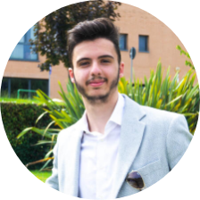

## Hi, I am Samuele Simone 👋

### Bio
* I build AI-powered optimization systems that improve the user acceptance of solutions in decision support systems
* Keen on Agentic AI, Local LLM and Human Interaction
* MSc Computer Science 
> Currently CS PhD Candidate @ University of Milan

### Contact
* samuelesimonedev@gmail.com
* Abruzzo, Italy

### Competences
`Python` `Machine Learning` `MIP`

  <i>Reach me! Let's talk </i>

    

